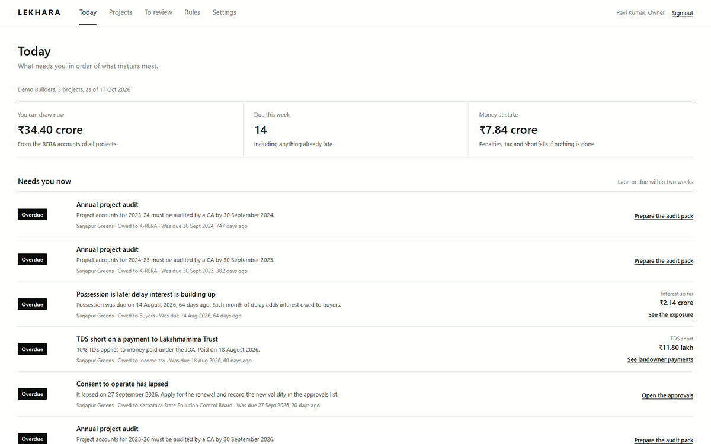
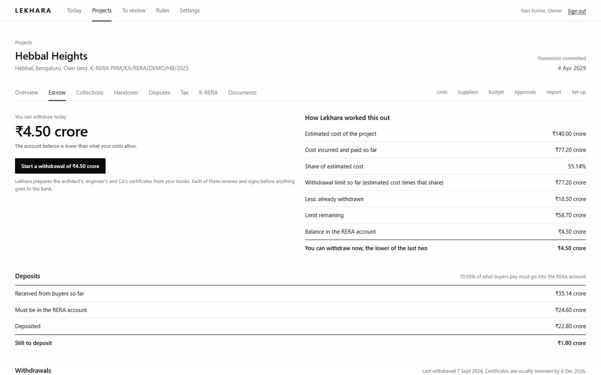
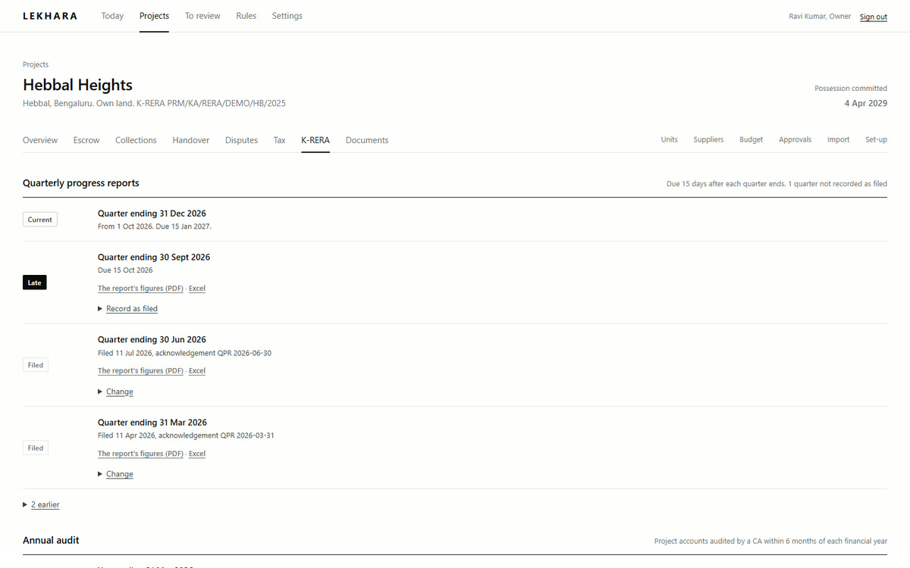
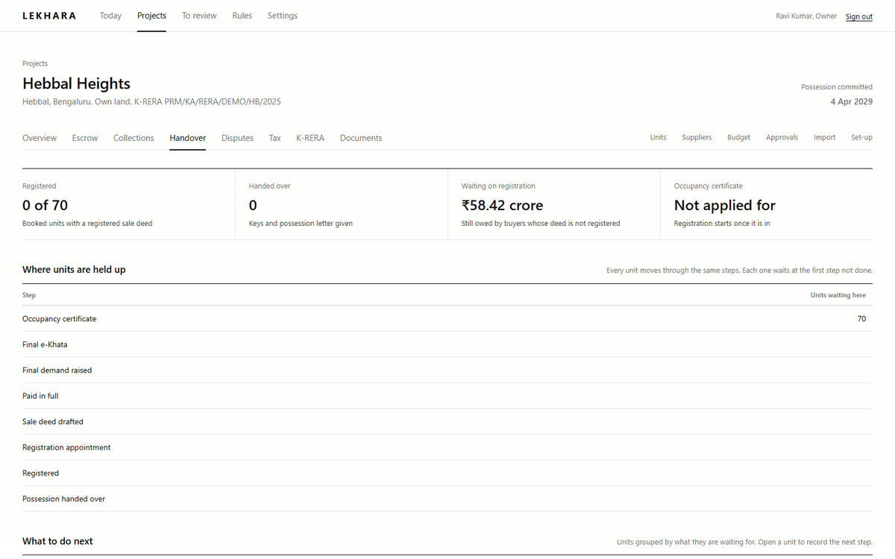

# Lekhara

**What your projects owe, worked out.**

The RERA account, K-RERA filings, tax, registrations and buyer complaints, kept track of for every project. 
For builders in Karnataka. Free for a month. Starting in Bengaluru.

[**Watch the video**](https://cdn.jsdelivr.net/gh/tfthushaar/lekhara@site/lekhara.mp4) · [What works today](#what-works-today) · [Pricing](#pricing)

<a href="https://cdn.jsdelivr.net/gh/tfthushaar/lekhara@site/lekhara.mp4">Watch it as a video</a>, 52 seconds

  
  
  
  

Every project you build owes something to someone: K-RERA, the bank that holds your RERA account, the tax department, your landowners and your buyers. Lekhara keeps track of all of it from the Tally files and bank statements you already have. It tells you what's due and what's late, and prepares the papers, so your architect, engineer and CA only have to check and sign.

## Your RERA account

- **How much you can withdraw today,** worked out from your costs and the balance in the account, with every step of the sum shown.
- **The certificates prepared for you.** Lekhara fills in the architect's, engineer's and CA's certificates from your books, checks that their figures agree, and follows the request until the bank releases the money.
- **A record of every signature.** Each certificate signed in Lekhara records who signed, when and from where, with a code your bank can use to check that nothing changed after signing.
- **The 70% rule watched for you:** how much of what buyers paid should be in the RERA account, and how much is still to go in.

## K-RERA

- **Quarterly updates and the annual audit,** prepared from your own records and shown as due, late or filed until you record the acknowledgement.
- **The figures for the K-RERA portal,** ready to download each quarter, and an audit pack with a draft for your CA to check and sign.
- **Delay interest, month by month,** when possession runs late, so you know what buyers can claim before they claim it.

## Tax

- **The 80% registered-supplier test** for residential GST, tracked through the year.
- **GST on development rights** for flats still unsold at completion on JDA projects, and what each sale before then saves you.
- **Sales priced more than 10% below guidance value,** flagged before you agree to them.
- **TDS on payments to landowners, labour cess, and MSME suppliers** coming up to the 45-day limit.
- **Your GSTR-2B checked against your bills:** which suppliers haven't reported their invoices, which amounts differ, and which invoices to accept, keep pending or reject in the GST Invoice Management System, and why.

## Registration and handover

- **Unit by unit, what stands between a buyer and registration:** occupancy certificate, e-Khata, final payment, sale deed and the appointment, with how much money is waiting on it.
- **A fact sheet for your lawyer's sale deed** and an estimate of the buyer's stamp duty and fees.
- **Possession letters** once the occupancy certificate is in, and a checklist of everything the residents' association needs, from the corpus fund to the keys.

## Complaints and orders

- **Every K-RERA, consumer and civil case in one register,** with hearings, deadlines, and what each one could cost, worked out from what the buyer actually paid.
- **What an order directs, to the rupee,** the date to comply by, and the last day to appeal with the deposit an appeal needs.
- **Weigh a settlement against the order** before you agree to it.

## Collections and landowners

- **Your payment plan** set up in a minute from a standard one, and demand letters that go out when your architect certifies a stage.
- **Buyers' payments** typed in, imported from your collections register, or matched to their units from your bank statement.
- **Landowners' shares kept straight:** every unit marked as yours or the landowner's, with entitlements, payments and TDS under each joint development agreement.

## Documents

- **Every paper filed against its project, unit, case or approval,** and searchable to the page it's on. Documents file themselves by your own rules, such as "fire NOC" meaning an approval.
- **Approvals and policies,** with a reminder before each one lapses.
- **Paper originals** each get a barcode label, so you know whether the title deed is in the safe, with the bank or with the lawyer.
- **Data rooms for lenders** that close on the date you choose. Every PDF a visitor opens carries their email and the date, visitors can be asked to accept your confidentiality terms first, and you get an email the first time each one opens the room.

## Your data, in and out

- **From Tally, by itself if you like.** The small Lekhara Connector on your Tally computer brings your books in every few minutes. It only reads Tally and opens nothing to the internet. Or export from TallyPrime or Tally.ERP 9 and drop the file in. Lekhara fills in suppliers, bills, buyers' payments, costs, the RERA account and landowner payments, and tells you exactly what the file is missing.
- **From your bank.** Drop in the statement from net banking, from any bank. Each buyer's payment is matched to their unit, including home-loan disbursements. Write your own rules for what repeats every month, and the same money is never counted twice.
- **Just forward it.** Every project has its own email address. Forward a statement, a Tally export, a bill or a document, or have your bank email statements there every month.
- **Edit anything,** one record at a time or many at once, with a history of who changed what.
- **Take it all out at any time.** Every list exports to Excel, and your whole workspace, with every document, downloads in one step.

## Your data, kept safe

- **Read-only.** Lekhara reads your systems and never changes them.
- **Each person sees only what they need.** Your CA sees what they certify, and a lender sees only what you share.
- **Every number leads back to its source document.**
- **Every sign-in and download recorded** in an access log your owner can read.
- **Passkeys or two-step sign-in,** which an owner can require for the whole team, and your password asked again before anything sensitive.
- **Support only when you ask.** Our team sees your workspace only if your owner allows it, for a few days, read-only, and every page they open is in your access log.
- **Yours to take away, or to delete.** Anyone can delete their own account. An owner can close the firm's account, and everything stays available to download for 30 days, then is deleted.

## What it doesn't do

- It doesn't replace your accounting. Tally stays.
- It never files, signs, submits or pays anything on its own.
- It doesn't run your site: no labour attendance or site diaries.

## Coming next

- **Reading documents for you,** including Kannada ones, with a choice to keep all of it inside India.
- **Sales and bookings,** channel partners, and agreements that are e-stamped and e-signed.
- **On WhatsApp:** a buyer portal, and approving bills with the budget and tax position in front of you.
- **Home-loan disbursements** tracked by bank and milestone.
- **Contractor bills, site progress from ordinary site photos, snags and the five-year defect liability.**
- **Guarantees and insurance,** and the conditions attached to each approval.
- **Plotted layouts:** which plots are released or mortgaged, and a stop on selling plots that aren't free yet.
- **New land:** an outright purchase against a joint development, with GST and the RERA account built in.
- **A Monday briefing,** and asking anything by voice in Kannada, Hindi or English.

## Pricing

One subscription for your whole firm, covering every project and everyone on your team. Your architect, engineer and CA join free. Your first month is free; after that, pay monthly by UPI AutoPay, card or bank mandate, with a GST invoice. Cancel any time and take your data with you.

## What works today

Lekhara is in development. Everything above "Coming next" works today:
- the RERA account and certificates;
- K-RERA filings and the tax checks;
- registration and handover;
- complaints and orders;
- collections, landowners and documents;
- bringing data in from Tally, bank statements, email and the GST portal.

We're opening to our first builders in Bengaluru as each part is ready, with other cities in Karnataka to follow.

## Get started

1. **Sign up** and start your free month. No call with us needed and nothing to install.
2. **Add your company** from its GSTIN, and each project from its K-RERA certificate.
3. **Drop in what you already have:** Tally exports, bank statements, your unit list from Excel or your CRM, and your approvals. Each project shows what's in, what's out of date, and where each missing piece comes in.
4. **Invite your team,** and your architect, engineer and CA, who join free.

---

Lekhara prepares figures, filings, certificates and packs for you and your professionals to check. It is not legal or tax advice, and nothing is filed, signed or paid without the person responsible.
